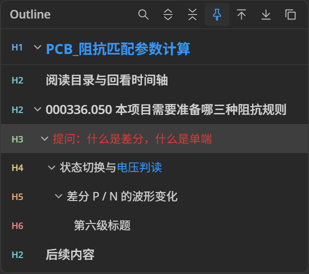

<p align="center">
  
</p>

# MdEditor

MdEditor 是基于 [MarkText](https://github.com/marktext/marktext) 开发的本地 Markdown 编辑器，支持所见即所得、源码编辑、公式和代码块，并扩展了工具栏、悬浮目录、图片布局与插件功能。

[下载最新版本](https://github.com/lingqifeng0/MdEditor/releases/latest) · [查看版本更新](https://github.com/lingqifeng0/MdEditor/releases) · [视频回看插件](https://github.com/lingqifeng0/MdEditor/releases/tag/video-study-v0.2.5)

## 下载与使用

目前提供 **Windows x64** 版本：下载 `setup.exe` 安装，或下载 ZIP 解压后运行 `MdEditor/MdEditor.exe`。

视频回看插件需要单独安装：在 **偏好设置 → 插件** 中导入 `.mtplug`，然后在插件设置里选择播放器程序。

插件可运行本地代码，请只安装可信来源的插件。

## 主要功能

- **文字工具栏**：快速设置文字格式、颜色、列表、公式和对齐；支持在设置中拖动图标交换顺序，并恢复默认顺序。
- **悬浮目录**：按标题层级导航、搜索和折叠；展开时 H1～H6 标识从冷色到暖色区分层级，标题沿用正文颜色。当前位置以浅色背景标记，收起后用蓝色刻度显示当前位置。
- **图片与 HTML 布局**：可视化移动、缩放和排列图片与文字框；文字框支持内容、字号和颜色设置。编辑窗口支持撤销、重做，并限制对象在 HTML 范围内。
- **搜索与本地附件**：搜索时可以选择和修改搜索词，关闭后再次打开仍保留内容；右键本地附件链接可打开所在文件夹。
- **插件扩展**：支持 `.mtplug` 安装、更新和管理，插件页面显示版本并提供独立设置。视频回看插件可通过时间戳定位视频，支持 [FrameFlow](https://github.com/lingqifeng0/FrameFlow)、mpv.net 和兼容 mpv JSON IPC 的播放器。

## 功能截图

| 悬浮目录 | HTML 图片与文字布局 |
| --- | --- |
|  |  |

工具栏按钮可以在设置中拖动排序：


## 开发与构建

需要 Node.js 22、pnpm 10.33.4。Windows 构建还需要 Python 及 Visual Studio C++ Build Tools。

```powershell
pnpm install
pnpm dev

# 构建 Windows x64 版本，随后生成便携 ZIP
pnpm build:win:x64
python scripts/package-portable.py
```

更多说明：[插件 SDK](docs/plugins/README.md) · [视频回看插件源码与配置](independent-plugins/video-study/README.md) · [Trellis 开发流程](.trellis/README.md)

## 开源与致谢

MdEditor 基于 [MarkText](https://github.com/marktext/marktext) 和 [Muya](https://github.com/marktext/muya) 开发，是独立定制版本。本项目的修改与新增代码采用 [MIT 许可证](LICENSE)；上游项目和第三方组件的版权与许可声明继续保留，详见 [NOTICE.md](NOTICE.md)。

部分文字颜色、对齐和布局以 Markdown 内嵌 HTML 保存，在其他编辑器中的显示取决于其 HTML 支持情况。
