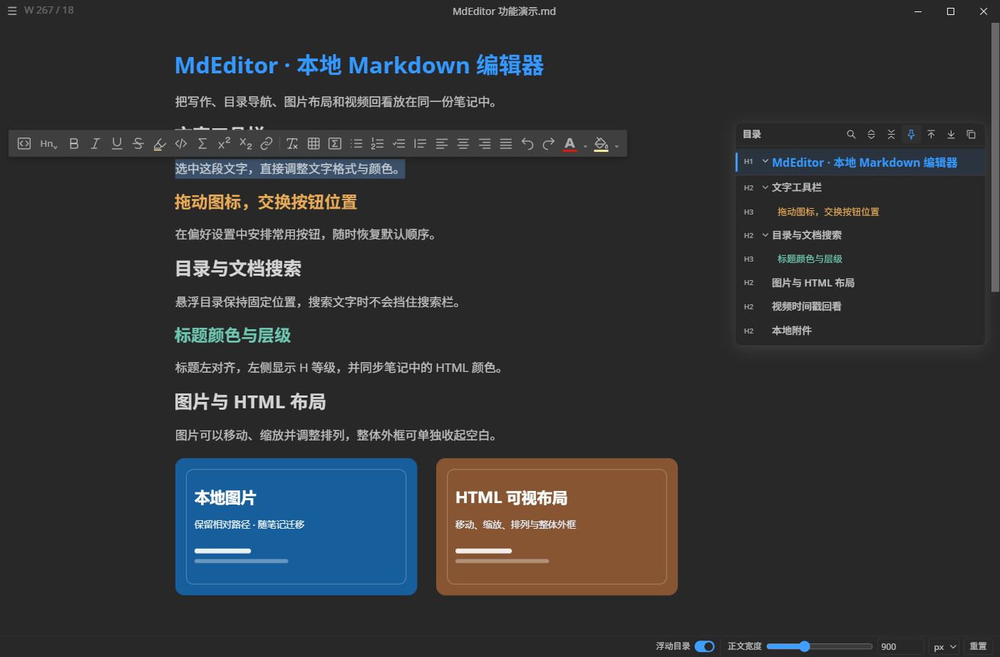
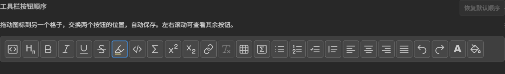
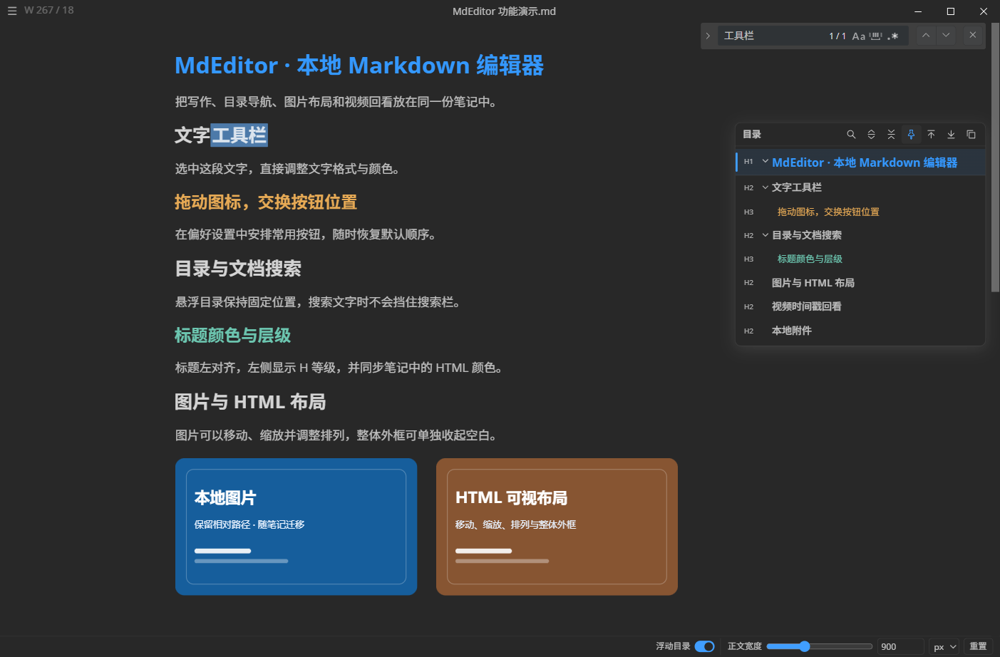
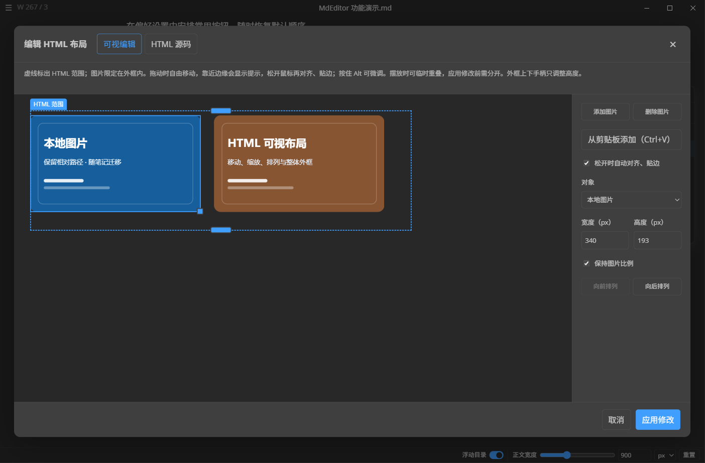
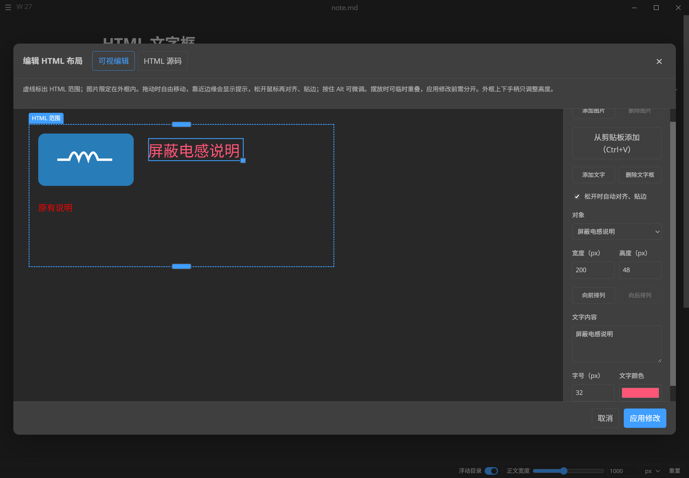
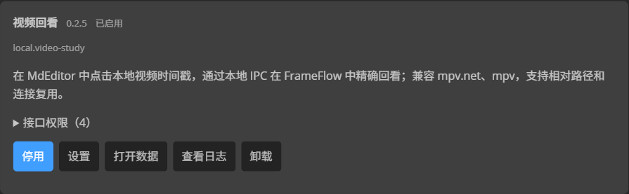
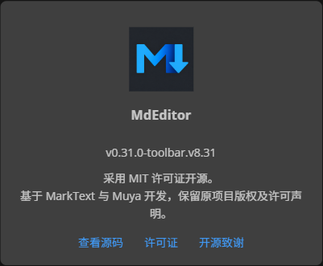

<p align="center">
  
</p>

# MdEditor

基于 [MarkText](https://github.com/marktext/marktext) 的本地 Markdown 编辑器定制版，重点改进文字工具栏、悬浮目录、图片与 HTML 布局，以及插件扩展。直接打开和保存 `.md` 文件，保留所见即所得、源码模式、数学公式、代码块和主题等原有能力。

当前版本：**`0.31.0-toolbar.v8.38`**，包含 HTML 文字框、HTML 编辑窗口内的撤销与重做、删除说明文字后图片保位、图像密集笔记的鼠标悬浮检测优化和文字框边界限制。悬浮目录收起时保留当前位置、父级和爷爷级的蓝色、青绿色和橙黄色刻度；展开后 H1～H6 标识按级别使用不同颜色，标题文字跟随正文颜色，当前位置用浅色透明遮罩提示。独立视频回看插件保持 **`0.2.5`**。本次版本以 **Windows x64** 为主要验证平台。

## 下载

从 [主程序最新 Release](https://github.com/lingqifeng0/MdEditor/releases/latest) 下载 Windows 安装器与便携 ZIP；[视频回看插件 0.2.5](https://github.com/lingqifeng0/MdEditor/releases/tag/video-study-v0.2.5) 单独发布，新增 FrameFlow 适配。更新插件时，在偏好设置中导入新的 `.mtplug`，原有播放器路径与设置保留。

## 界面预览

文字工具栏与悬浮目录，使用演示笔记拍摄：



## 新增和改进的功能

### 可排序的文字工具栏

- 选中文字后使用悬浮工具栏，集中操作标题、加粗、斜体、下划线、删除线、高亮、代码、公式、列表、对齐和文字颜色等格式。
- 在 **偏好设置 → 编辑器 → 工具栏按钮顺序** 中，直接拖动一排图标格子调整顺序。拖到另一个格子后，两项交换位置，其余按钮保持原序。
- 顺序自动保存，重启后保留；提供 **恢复默认顺序**。
- 文字颜色、背景颜色支持预设色、自选颜色及清除颜色。高亮使用荧光笔图标，清除格式使用 `T×`，避免两个操作混淆。



### 更清楚的悬浮目录

- 标题左对齐，`H1`～`H6` 层级标识放在左侧，使用紧凑缩进区分层级，为标题正文留出空间。
- 正文标题通过 HTML 设置的整行颜色和局部文字颜色，同步显示在目录中。
- 支持目录搜索、展开与折叠、固定、定位到当前标题、跳至首尾及复制目录。
- 目录固定在编辑区顶部下方的位置，打开或关闭文档搜索、切换替换模式时保持原位。
- 展开面板采用统一、不透明的主题底色，减少图片或正文透过行间空隙形成的杂乱条纹。

### 文档搜索与选择操作修复

- 搜索栏与悬浮目录分开布局，降低鼠标操作时误触目录的机会。
- 在搜索框里拖选并修改部分文字，或拖到框外松开鼠标，不会自动关闭搜索栏。
- 关闭后再次打开，保留搜索词和替换内容；从正文选中新内容后打开搜索，仍可用选区预填。
- 改进文字选择、格式操作与撤销时的视口保持，减少页面突然跳动。



### 图片与 HTML 可视布局

- 为 HTML 图片组提供可视编辑面板，可选择、移动、缩放、排列图片和文本对象，并切换到 HTML 源码查看或修改。
- 单张图片可以保持原比例缩放；整体外框可以单独调整宽高、收起底部空白，保留组内图片的布局。
- 支持应用、取消和对象还原，改进编辑后保存、重新打开与撤销时的布局保持。
- 改进图片粘贴、相对 `assets` 目录、本地文件同步，以及保存和关闭期间的图片资产清理。
- 图片删除区分删除链接、删除文件等操作，减少正文和磁盘图片状态不一致的问题。



v8.35 在右侧增加 **添加文字** 和 **删除文字框**。新增后自动选中并进入文字输入，可拖动、调整宽高，并对整个文字框统一设置字号与颜色。文字框现在会以 HTML 外框为定位基准，拖动和缩放不会越过外框；空文字框、多行内容和特殊字符可以保存在 HTML 中，支持取消、应用、撤销及保存后重新打开。



同一个 v8.35 版本还提供 HTML 编辑窗口独立的 **撤销 / 重做**，支持 `Ctrl+Z`、`Ctrl+Shift+Z` 和 `Ctrl+Y`。可撤销新增、删除、拖动、缩放、文字样式和源码修改；弹窗打开时，菜单快捷键也作用于当前草稿。删除图片下方说明时保留图片、分组和外框的原位置。编辑器悬浮工具优先使用鼠标事件已有的目标，减少滚动经过大图片时的重复位置检测；悬浮目录使用二分定位、目录行缓存和滚动空闲后补测，减少长时间滚动时的主线程压力。


### 本地附件右键定位

正文中的本地文件链接可以右键选择 **打开所在文件夹**，在资源管理器中定位并选中文件。支持 `assets` 下的图片、PDF、工程文件和安装包；相对路径按当前 Markdown 文件所在目录解析，支持中文与空格。

### 通用插件平台与独立设置

- 提供 **SDK 2 / API 2** 插件平台，支持导入 `.mtplug`、导入文件夹、拖入安装、更新、启用和停用。
- 插件管理页显示插件版本，提供独立设置入口和日志查看。
- 自定义设置页按内容高度展开，内容较长时使用外层偏好设置页面滚动。
- SDK 提供文档读取与编辑事务、命令、按钮、视图、事件、元数据、设置、存储及桌面能力。
- 插件 ID、业务版本、API 版本分别维护。现成的 Obsidian 插件和旧 SDK 1 插件需要适配。

桌面插件可以运行 Node.js 代码，应只安装可信来源的插件。SDK 权限声明不等同于操作系统沙箱。



### 视频时间戳回看插件

视频回看是仓库内的**独立插件**，通过本地 IPC 在 [FrameFlow](https://github.com/lingqifeng0/FrameFlow) 中打开视频并精确定位到笔记对应时间，也兼容 mpv.net 和 mpv。支持相对视频路径、播放器连接复用、播放或暂停选项，以及回看时显示播放器窗口。

```markdown
[00:01:23.250](<../视频.mp4#t=83.250>)
```

保存 Markdown 后，`Ctrl`＋点击时间戳，或使用编辑器的“打开链接”入口回看。视频地址相对于当前笔记解析；移动笔记与视频时保留相对目录。

插件 0.2.5 取消播放器文件名白名单，使用你自行选择的 `.exe` 路径，并在实际回看时验证兼容接口。支持 FrameFlow 的默认通信管道和迁移保留的旧管道。加载视频时携带明确起始时间，随后核对精确定位结果，使笔记时间戳优先于播放器的历史断点。无法复用连接时，创建独立回看实例。以上逻辑全部属于独立插件。

保留 0.2.2 对保存设置时提示区高度变化、带动“链接写法”等说明上下闪动的修复。常规反馈预留三行，长路径换行时在检查期间保留完整高度。

插件与主程序分别更新。安装或更新主程序后，已有插件不会自动替换；在 **偏好设置 → 插件** 中导入新 `.mtplug`，可保留原有播放器路径和设置。

### 名称、图标与设置入口

- 软件显示名称统一为 **MdEditor**，使用深色正方形背景的蓝色 `M` 与向下箭头图标，并提供配套 Markdown 文件关联图标。
- “偏好设置”直接点击打开，保留 `Ctrl+,` 快捷键。
- 便携 ZIP 的顶层文件夹为 `MdEditor`，程序文件名为 `MdEditor.exe`。为兼容已有配置与文件关联，数据目录仍为 `marktext-user-data`。

## 源码结构

```text
MdEditor/
├─ packages/desktop/                Electron + Vue 主程序
├─ packages/muya/                   当前使用的编辑器内核
├─ plugins/                         SDK 2 示例插件源码
├─ independent-plugins/video-study/ 独立视频回看插件源码
├─ docs/plugins/                    SDK、声明、安装包规范与开发说明
├─ scripts/                         构建、资源生成与便携包脚本
└─ README.md
```

仓库保留运行、构建与维护所需的源码、资源和测试，不收录依赖缓存、编译输出、安装包、用户笔记、用户配置、旧版交付目录或本机测试临时记录。未使用的旧 `muyajs` 引擎和上游网站工程也未纳入。

## 本地开发与构建

需要 Node.js 22、pnpm 10；项目锁定 pnpm `10.33.4`。Windows 上重建原生依赖需要相应的 Python 和 Visual Studio C++ Build Tools。

```powershell
pnpm install
pnpm dev
```

`pnpm install` 会处理 Electron 原生依赖、语言文件与编辑器类型声明。首次安装需要下载开发依赖。

```powershell
# 类型检查与主程序单元测试
pnpm typecheck
pnpm test:unit

# Windows x64 安装包与 ZIP
pnpm build:win:x64

# 生成顶层目录为 MdEditor 的便携 ZIP，需要 Python 3.10+
python scripts/package-portable.py
```

构建结果写入 `dist/`。便携包使用下面的目录结构：

```text
MdEditor/
├─ MdEditor.exe
├─ resources/
├─ 其他运行所需文件
└─ marktext-user-data/
   ├─ plugins/
   └─ plugin-data/
```

## 构建与安装插件

生成 SDK 声明与示例插件：

```powershell
node scripts/build-platform-plugins.cjs
```

在仓库根目录构建视频回看插件，复用已安装的主程序开发依赖：

```powershell
$env:MARKTEXT_SDK_SOURCE = (Get-Location).Path
node independent-plugins/video-study/scripts/build.cjs
node --test independent-plugins/video-study/test/*.test.cjs
```

视频插件还需要 Windows .NET Framework C# 编译器来生成它自己的进程身份检查程序。产物位于 `independent-plugins/video-study/dist/`；将 `local.video-study-0.2.5.mtplug` 导入编辑器并启用后，在插件设置里选择你使用的播放器 `.exe`。支持 FrameFlow、mpv.net 和兼容 mpv JSON IPC 的播放器，程序文件名可以自定义。

示例插件安装包生成到 `dist/plugins/`。

## 项目开发流程

项目已接入 Trellis，开发规范位于 `.trellis/spec/`，需求、已确认设计和验收记录位于 `.trellis/tasks/`。入口说明见 [Trellis 开发流程](.trellis/README.md)。主程序与独立插件的职责分开记录，涉及插件设计或模块边界调整时，先说明方案并获得确认。

Trellis 用于开发管理，相关脚本和会话记录不进入应用运行包。当前采用 Codex inline 流程，保留原有 AGENTS.md 约定，使用临时配置和生成的笔记验收。

详细接口见 [插件 SDK 文档](docs/plugins/README.md)，播放器配置与通信说明见 [视频回看插件说明](independent-plugins/video-study/README.md)。

## 格式兼容与许可

文字颜色、背景颜色、部分对齐与布局会使用 Markdown 内嵌 HTML 保存；在其他 Markdown 软件中的显示取决于其 HTML 支持情况。视频时间戳本身保留为普通 Markdown 链接。

MdEditor 基于 MarkText 与 Muya 开发。本项目的修改及新增代码采用 [MIT License](LICENSE) 开源；原项目及第三方组件的版权和许可声明予以保留。完整来源与致谢见 [NOTICE.md](NOTICE.md)。

上游项目：[MarkText](https://github.com/marktext/marktext)、[Muya](https://github.com/marktext/muya)。本仓库是独立定制版本，不代表上游官方发布。
